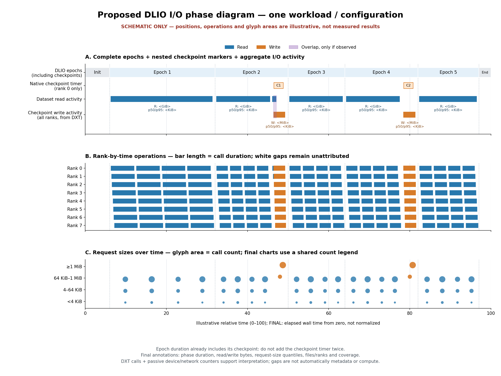

# DLIO phase/access study — execution plan and chart proposal

**Status: chart design approved.** The user approved panels A, B and C,
particularly A and C. Treat A/C as the primary explanatory views and B as
supporting rank-level detail; retain all three in the detailed chart.
The instrumentation/orchestration/analysis implementation is now in
[`scripts/workloads/dlio/profiling/`](../../scripts/workloads/dlio/profiling/README.md).
Existing workload runners are unchanged. No cluster workloads have been
launched during implementation; cluster runtime compatibility and full-case
coverage must pass the supplied preflight/first-case checks.

Implementation detail: reuse the **existing installed Darshan versions** for
per-process POSIX/DXT capture, including reader children, while leaving the
application's MPICH/mpi4py stack unchanged. No rebuild, upgrade or system
configuration change is required by the implementation. Runtime discovery
reuses the earlier scripts' paths and `DARSHAN_RUNTIME_LIB`; an MPI-linked
runtime must match mpi4py's active MPI and pass the tiny capture preflight.
PID/owner-rank and traced clock markers map per-process logs back to eight
application ranks. MPI-IO tracing is not claimed; STDIO aggregate records
are retained for POSIX coverage checks. Incompatible capture stops the run,
not silently replaces the server software.

**Review outcome:** the design is suitable for explaining phase/access behavior,
provided the corrections below are followed. It is not a metadata-server
bottleneck experiment or a new statistically replicated performance study.
Section 10 defines the defensible observations and presentation priorities.

## 1. Objective and scope

Explain the completed DLIO **U-Net 3D and reduced CosmoFlow** results through
measured I/O activity across application time:

- When does each initialization, epoch and checkpoint phase occur?
- Which intervals are read-dominant, write-dominant or genuinely overlapping?
- What are the actual API request sizes, transferred volumes and durations?
- Are accesses contiguous within individual files, and how are files shared
  across ranks? Distinguish this from randomized file visitation order.
- How do the phases relate to the existing storage, cache, network and
  metadata microbenchmarks?

The completed uninstrumented runs remain the performance baseline. The new
runs characterize behavior; their timing is not silently substituted for
the existing three-repetition performance results.

The historical U-Net normal runs predate the latest server-cache-drop/wait
changes. Verify provenance before calling a historical baseline a matched
control. Different cache preparation or source provenance is a confounder,
not proof of Darshan overhead. New traces use one recorded current protocol
across all 12 cases. Historical and profiled configurations must have separate
labels and a comparability table listing known differences and unknowns.

ResNet is excluded by scope. This does not assume ResNet and U-Net are
identical: training workloads can have different formats, record sizes,
batching, file counts and I/O paths.

## 2. Approved scope correction: 12 instrumented invocations

| Workload | Normal configurations | Throttled configurations | Invocations |
|---|---|---|---:|
| U-Net | Default / HDD / SSD: pools 1, 3, 6 | 4/0, 2/2, 0/4: pools 14, 16, 18 | 6 |
| CosmoFlow | Default / HDD / SSD: pools 1, 3, 6 | 4/0, 2/2, 0/4: pools 14, 16, 18 | 6 |
| **Total** | | | **12** |

Run **one full invocation per workload/configuration**, not three
repetitions. Each invocation retains **all five epochs** and both checkpoint
events. U-Net's previously completed five-condition throttled comparison
remains intact; this trace study intentionally samples only three conditions.

### Workload invariants

| Setting | U-Net | CosmoFlow |
|---|---:|---:|
| MPI ranks, on anjuna2 | 8 | 8 |
| Reader threads per rank | 4 | 4 |
| Input files per pool | 168 NPZ | 8,192 TFRecords |
| Batch size per rank | 4 | 1 |
| Epochs | 5 | 5 |
| Simulated computation time | 0 | 0 |
| Checkpoints | After epochs 2 and 4, all ranks | After epochs 2 and 4, all ranks |
| Configured model bytes per rank | 499,153,191 | 100,000,000 |

Preserve file/sample shuffle settings, prefetch settings, reader implementation,
checkpoint implementation, dataset contents, placement and current cache
protocol. Request size is **not** prescribed from batch size or record length:
the purpose of tracing is to measure the actual calls.

## 3. Instrumentation-only implementation boundary

After approval, add a narrowly scoped profiling orchestration entry point
that reuses the current preparation, invocation and pool-administration
mechanics. Do not replace the workload framework or change training logic.

Allowed differences from the corresponding current run:

1. One invocation per configuration instead of three repetitions.
2. Darshan runtime injection and DXT configuration for the DLIO rank
   processes, using a build compatible with the active MPICH/mpi4py stack.
3. Separate trace/result destinations and provenance/coverage recording.
4. Instrumentation-only time anchors if existing timestamps cannot align
   the trace and application phases at sufficient precision.
5. Passive, timestamped device/network counter sampling to correlate trace
   phases with backend traffic. This is observation only, not new I/O load,
   cache manipulation or filesystem tuning.

Do not change MPI implementation, rank count, batching, access order,
checkpoint durability, computation time or data volume to make tracing easier.
Darshan must cover the actual reader processes, including any subprocess
readers where applicable; enabling it only on the outer Python runner is not
sufficient. Record rank and process coverage rather than assuming it.

The application writes normal DLIO evidence as before. Preserve synthetic
checkpoint sizes and the existing no-explicit-fsync save behavior. Write
instrumentation logs outside the BeeGFS dataset/checkpoint paths so trace
output itself is not mixed with application data I/O in the chart.
Run any inventory, content validation or representative layout queries
before the final cache preparation. Do not scan/hash the dataset after the
cache drop and accidentally warm it before the measured invocation.

### One-command orchestration behavior

- Select U-Net, CosmoFlow, or both, with a fixed six-configuration matrix per
  workload. Preserve the workload-specific script style of the current suite.
- Begin with original pool 6 membership and no experiment caps.
- Run normal pools 1, 3 and 6 without moving their targets.
- Move the experimental targets 104, 205, 305, 306 through 14 → 16 → 18,
  installing/verifying 45/15 MiB/s read/write caps and four-target, 512-KiB
  patterns as in the current experiment.
- Restore pool 6 and clear caps before changing workloads and at completion.
- Before every invocation: client sync, sync/cache drops on colva1–4, client
  cache drop, then 30 seconds of waiting. No cache drops between epochs.
- Keep preparation outside DLIO's measured start/end interval. Traces must
  not accidentally include controller-side copies as training I/O.
- Reuse the existing stop/restore and progress concepts for reservation
  boundaries. A partial invocation is retained as incomplete and restarted;
  it does not count as the configuration's completed trace.
- On failure, stop further workload launches, stop the owned MPI process
  group, save the failure and attempt restoration. Report failed restoration
  explicitly instead of claiming that the cluster is normal.

No new cluster run is authorized until the design is approved. Validate
instrumentation compatibility without an additional full DLIO pilot; validate
coverage of the first planned invocation before scheduling the remaining ones.

## 4. What must be captured

### Darshan and DXT

- Per-file/per-rank POSIX records; STDIO records if that interface is used.
- DXT read/write events with rank/process, file identity, start/end, length
  and offset. Enable tracing for both dataset and checkpoint files, not only
  slow accesses or a sampled subset.
- A recorded DXT memory/record budget sized for the expected call counts.
  Do not silently accept trace truncation or rank/file-record loss.
- MPI-IO records if present, but do not assume MPI ranks imply MPI-IO data
  access. DLIO readers may perform ordinary POSIX/STDIO I/O.
- Metadata-related aggregate counters/times available in the runtime.
- Preserve per-rank records where supported by the installed Darshan
  configuration; shared-record reduction must not silently erase rank-level
  information needed by the analysis. Record the reduction policy.
- Measure and record tracing memory use/record limits: instrumentation can
  consume RAM and affect caching, not just add a small timing cost.

Use one documented API layer for byte accounting. Do not add POSIX, STDIO
and MPI-IO volumes together when they describe the same underlying access.
DXT's API-call timings are **not physical device-service timings** and do not
identify which cache supplied a read.

### Existing evidence, preserved beside the trace

- Full DLIO config, summary, per-epoch stats, all rank outputs and console.
- Physical-device before/after counters, actual placement evidence and
  configured/effective cap checks.
- Add low-overhead sidecar time series (initial target: 1-second sampling)
  of physical-device read/write bytes and client/server network bytes on
  involved hosts. Use one persistent sampling process per host rather than
  repeated SSH launches. Resolve live target/device/interface mappings,
  avoid double-counting partitions and parent devices, and save units and
  clock anchors. Record pre/post quiet-window traffic and unrelated-load
  caveats: these counters are host/device-wide, not application-exclusive.
  Resolve telemetry gaps rather than fabricating per-phase device rates.
- Record lightweight process CPU time/RSS and available-memory context if
  obtainable by the same passive collection. Zero simulated computation does
  not eliminate decoding, allocation, copies, batching or synchronization.
  Such samples provide context, not a new CPU-profiling benchmark.
- Source revision and working-tree state; MPI, mpi4py, DLIO and Darshan
  versions; instrumentation settings and launch environment.
- Trace clock origin, application clock origin and alignment uncertainty.
  Never align them by simply treating the first read as the first epoch.

Only passive instrumentation is added. The counters do not introduce a
second benchmark or additional DLIO invocation. If this telemetry is
unavailable, diagrams remain possible, but cache location and phase-specific
backend traffic stay explicitly unverified. Do not readjust workload memory,
prefetch or cache settings to compensate for tracing overhead.

### Coverage acceptance before interpretation

1. All eight ranks and any reader processes are accounted for.
2. All five epochs and both checkpoint windows are covered.
3. Dataset and checkpoint paths occur in the expected API records.
4. No reported truncation, missing modules or trace-buffer exhaustion.
5. DXT operation counts/bytes reconcile with the corresponding aggregate
   Darshan records, allowing only documented interface-specific differences.
6. Application steps/checkpoint evidence match the unchanged workload.
7. An untraced operation path (for example memory mapping or an unsupported
   library path) is identified as a coverage gap, not zero I/O.
8. Reader threads/processes are identified from the installed DLIO execution
   path and observed processes. Data-loader workers may not have their own
   MPI rank, and LD_PRELOAD inheritance alone does not prove their Darshan
   lifecycle or log coverage. Preserve worker/process identity where available;
   do not merge separate worker streams as if they were one sequential reader.
9. Disabled modules, reductions, timestamp precision, cumulative counter
   discontinuities and DXT drops are included in the coverage report.

Coverage does not require every process to issue calls in every epoch.
Legitimate rank imbalance or a loader reusing memory can yield no calls in
a phase. Distinguish such cases from absent worker/module coverage using
the execution-path checks, native phase evidence and traffic counters.

If these checks fail, do not publish a full-coverage phase interpretation.
Resolve the instrumentation gap and explicitly identify any needed rerun.

## 5. Phase-wise chart proposal — approval target

**The image is a layout mockup, not a trace or a prediction.** Its normalized
time positions and operations are illustrative. Final figures use elapsed
seconds/minutes from the measured application start and actual DXT events.

### Recommended main chart: three aligned panels

**A — Application phase band and aggregate I/O activity**

- One shared wall-clock x-axis, beginning at zero.
- Upper band: initialization, complete epochs E1–E5, and finalization,
  aligned using DLIO timestamps. A second thin row marks native checkpoint
  timers **inside epochs 2 and 4**; these timers are explicitly rank-0-based.
  The all-rank write lane comes from DXT and may extend beyond those markers.
  Do not draw a full epoch followed by the same checkpoint again: DLIO's
  epoch span already includes that checkpoint.
- Below it, separate blue **dataset-read** and orange **checkpoint-write**
  lanes show the union of traced call intervals across the ranks. Unexpected
  dataset writes/checkpoint reads remain visible under their actual file role
  and operation, rather than being forced into the expected pattern.
- True read/write overlap is shown in separate concurrent lanes; a purple
  overlap marker is used only where intervals actually overlap. A single
  phase containing reads followed by writes is not automatically concurrent.
- Phase annotations report elapsed span, total R/W bytes and request-size
  summaries. Example label format: `E1 | R <GiB>, W <MiB> | read p50/p95 <KiB>`.
  These values will come from the trace, not configured record size.

**B — Rank-by-time operation raster**

- Eight rank rows (additional child-process subrows if needed).
- Each operation spans its actual start/end. Blue = read; orange = write.
  Preserve rank/file identity for drill-down. White means no observed
  instrumented read/write call, not proof of computation or idleness.
- This shows concurrent activity, staggered checkpoint completion and
  stragglers that an aggregate phase bar would hide.
- Raw requests remain available; dense static views may rasterize/bin for
  rendering, but must disclose that reduction and retain exact zoom views.

**C — Request sizes across the same time axis**

- Categorical size bands: `<4 KiB`, `4–64 KiB`, `64 KiB–1 MiB`, `≥1 MiB`,
  with exact boundary rules recorded by the analyzer.
- Within fixed time bins, blue/orange glyphs show read/write call counts by
  size band. Glyph area encodes count; it does not encode elapsed time.
- Exact request sizes and per-phase p50, p95, maximum and modal sizes appear
  in annotations/tables and interactive hover. Clearly distinguish
  syscall/request size from file size, sample size and BeeGFS stripe chunk.
- Size quantiles are operation-count-weighted unless explicitly labelled
  otherwise. Provide both operation-count share and byte share: many tiny
  calls can dominate count while a few large calls dominate transferred bytes.
- Use one fixed overview bin width (initial proposal: 5 seconds) and the same
  glyph-area/count legend across comparable configurations. Keep exact events
  for zooms. Counts in bins use a documented completion-time rule; the panel
  is not instantaneous physical-disk bandwidth. Exact bin boundaries are
  `[0,4 KiB)`, `[4,64 KiB)`, `[64 KiB,1 MiB)`, `[1 MiB,infinity)`.
- The initial proposal is a static PNG/SVG plus an HTML drill-down, not a
  requirement to deploy a dashboard or a new service.

Phase annotations may use a per-phase detail table when five-epoch labels
would be too dense. Read/write dominance is a measured byte-share label,
not a guess based on the workload name. If using a 90% dominance threshold,
state it explicitly; otherwise show R/W shares directly. Show intensity as
bytes/calls per wall-time bin, not merely the word "heavy".

### Configuration comparison chart

For each workload, make a companion view with six configuration rows,
grouped as normal (Default/HDD/SSD) and throttled (4/0, 2/2, 0/4).
Use the **same absolute time scale** within that figure. Phase widths must
expose changes in cold first-epoch duration and checkpoint duration; never
stretch every run to equal length in the main comparison. Each row may have
separate read/write sublanes and a phase strip. Use zero-based numeric axes.

CosmoFlow is the primary worked example; apply the identical encoding to
U-Net. Do not put incompatible workload sample rates on one shared scale.

### Pattern detail when needed

Use a file-offset-versus-time view for selected representative dataset and
checkpoint files. Contiguous, forward-noncontiguous and backward accesses
are determined **within a file/rank stream**, not by concatenating unrelated
files. Seeded file shuffling alone does not prove random offsets within files.
Preserve stream interleaving caveats when DXT cannot identify threads.
Even after sorting by start time within a file/rank, interleaved reader
threads can appear offset-discontinuous. Without thread/stream identity,
describe the observed offset ordering rather than claiming that the reader
algorithm is intrinsically random.

## 6. Phase reconstruction and accounting rules

- Epoch/checkpoint semantics come from native DLIO timestamps. DXT describes
  the actual calls inside and across those boundaries, including prefetch.
- Maintain a non-overlapping wall-time partition: initialization + each
  complete epoch + inter-epoch gaps + finalization = full run. Native
  checkpoint timers and DXT checkpoint-call unions are nested annotations,
  not extra durations added to that total. Input-block timers can be shown
  where available; missing U-Net block timers remain unavailable, not zero.
- Use native timestamp differences when available, not rounded duration
  strings. State whether each native boundary is rank-0-observed. Clock
  uncertainty bounds the precision of phase attribution, especially for
  small checkpoint intervals. Show uncertainty if boundaries cannot be
  aligned reliably; do not imply millisecond precision from second-level anchors.
- A call crossing a boundary is tagged as crossing; do not invent the
  distribution of its bytes across phases. Count its bytes once using a
  documented attribution rule (such as completion phase) and retain both
  boundary timestamps. Aggregate rates derived this way are labelled.
- Record phase wall duration, R/W bytes, operation counts, size statistics,
  unique files and ranks, temporal overlap and offset-pattern statistics.
- Sum bytes/counts across disjoint events. For elapsed activity, use interval
  unions or per-rank values: eight simultaneous one-second calls are not
  eight seconds of application wall time.
- Preserve the completed-study end-to-end definition:
  `processed samples across all epochs / full-run elapsed seconds`.
  Do not return to arithmetic means of epoch rates for pool performance.
- Separate profiled phase durations from the uninstrumented baseline and
  report timing differences descriptively, not as causally isolated
  instrumentation overhead. A single profiled
  run is not a replacement for three-repetition variability estimates.
- For checkpoints, report both the native rank-0 save timer and all-rank DXT
  write activity. Neither is necessarily time to durable storage. Time not
  covered by traced write calls is **unattributed**, not automatically
  serialization, compute, metadata, synchronization or physical I/O wait.
- Distinguish processed samples from files touched: prefetch and dropped
  incomplete batches can read data that is not counted as processed. Compare
  actual API bytes with nominal sample volume only as a labelled ratio, not
  as an exact physical-read amplification factor.

## 7. Correlation with existing microbenchmarks

| Observed trace property | Existing comparison | What can be concluded |
|---|---|---|
| Large contiguous calls in cold-read phases | Local sequential FIO; BeeGFS cache/backend reads | Whether bulk bandwidth is a plausible contributor; not a direct mapping of local-device rates to application rates |
| Small/offset-discontinuous reads | Matching FIO transfer-size/random-access cases | A potential sensitivity to latency/IOPS; compare concurrency, queue depth and filesystem path before making numerical claims |
| Repeated reads become faster across epochs | Buffered/native cache read studies and DLIO device counters | Consistency with cache effects; DXT alone cannot distinguish client RAM from server RAM |
| Write bursts during checkpoints | Cache-write fsync-policy cases and sequential writes | Buffering/durability context; existing torch/TF save timings do not prove durable media throughput |
| Many small-file opens/stats/close activity | mdtest cases, with layout/rank/target context | Metadata intensity context; not proof that mdtest ops/s predicts application throughput |
| Read/write traffic near path capacity | Same-client/direction iperf3 measurements | Network capacity context, not proof of active BeeGFS transport or network saturation |
| Longer first epoch under caps | Verified effective caps, DXT timing and device counters | Correlation between capped data path and cold-read cost; do not assume one slow target universally fixes every workload's throughput |

Use the actual preserved microbenchmark artifacts and retain their dates,
targets, transfer sizes, concurrency, caching and durability differences.
The existing metadata targeted run and its raw cases are available locally;
older methodology text claiming it is pending must not override the evidence.

**Metadata limitation:** standard DXT read/write events are not a complete
timestamped trace of opens/stats, BeeGFS metadata RPCs or MDS service times.
Aggregate metadata counters can support a whole-run summary, not an invented
per-epoch metadata lane. If exact metadata phase timing is essential, that is
a separate instrumentation decision to approve, not something to claim from
ordinary DXT. Likewise, missing read/write events are not "metadata time".

## 8. Work breakdown and deliverables after approval

1. **Approve the mockup and matrix.** Confirm the three-panel layout,
   six configurations per workload and instrumentation-only boundary.
2. **Prepare instrumentation.** Verify compatible runtime/modules,
   process coverage, trace limits, path filters and time alignment; record
   a parameter manifest showing workload settings are unchanged.
3. **Add narrow orchestration.** Reuse current run mechanics, make repetition
   count one for profiling, use a dedicated output root, and enforce
   stop/save/restore behavior. Keep normal performance runs separate.
4. **Collect the 12 planned invocations.** Review first-trace coverage before
   continuing. Archive native logs even when an invocation is incomplete.
5. **Extract reproducible evidence.** Per-operation events, phase boundaries,
   per-phase sizes/bytes/counts, per-file/rank sharing/pattern summaries,
   coverage report and source provenance. Export CSV/Parquet as appropriate.
6. **Generate the approved diagrams.** One detailed phase chart per
   workload/configuration (12), one comparison per workload (2), and selected
   offset/size detail views only where useful. Annotate trace limitations.
7. **Write the interpretation.** Correlate with current performance and
microbenchmarks, distinguishing measured facts from hypotheses and
explaining why a many-file workload is not automatically metadata-bound.

## 9. Visualization references and design rationale

1. **Bez et al., PDSW 2021**, *I/O Bottleneck Detection and Tuning: Connecting
   the Dots using Interactive Log Analysis*, pp. 15–22,
   [DOI: 10.1109/PDSW54622.2021.00008](https://doi.org/10.1109/PDSW54622.2021.00008).
   The DXT Explorer project identifies this as its associated paper; its
   companion examples include FLASH, E2E and OpenPMD. Basis for aligned
   operation/time, transfer-size and offset views, not a claim that our
   proposed composite chart is reproduced from the paper.
2. [DXT Explorer operation plot](https://dxt-explorer.readthedocs.io/en/latest/operation.html):
   per-rank reads/writes over time, with duration, size and offset details.
3. [Transfer plot](https://dxt-explorer.readthedocs.io/en/latest/transfer.html):
   size-binned requests over time. Basis for panel C.
4. [I/O phase plot](https://dxt-explorer.readthedocs.io/en/latest/iophase.html):
   grouped I/O phases and fastest/slowest rank context. We prefer native
   DLIO epoch/checkpoint boundaries for semantic labels, rather than silently
   treating a gap-based grouping threshold as an epoch detector.
5. [Spatiality plot](https://dxt-explorer.readthedocs.io/en/latest/spatiality.html):
   per-file access offsets for contiguous/strided/random pattern inspection.
6. [DXT Explorer repository and citation](https://github.com/hpc-io/dxt-explorer).

## 10. Critical review: what makes this a defensible study

### Corrections made before implementation

| Potential flaw | Resolution |
|---|---|
| An attractive phase chart is mistaken for a causal explanation | Define questions, measurements and competing explanations below; allow results to contradict the initial hypothesis |
| Full epoch durations plus checkpoint durations double-count elapsed time | Nest checkpoint markers within epochs; keep a non-overlapping wall-time partition |
| Rank-0 checkpoint timing is called all-rank checkpoint duration | Label the native timer as rank-0-based; independently show all-rank traced write intervals |
| DXT alone is said to prove caching, disk bandwidth or MDS cost | Add passive phase-aligned traffic counters; qualify host-wide attribution and retain metadata limitations |
| File size, sample size, stripe chunk and syscall size are conflated | Separate configured geometry, actual file sizes, API request lengths and backend device bytes in tables and labels |
| A single profiled repetition is treated as statistical validation | Use it for characterization; use existing three-run results for performance/variation and audit cache/source differences |
| Instrumentation changes the workload or competes with it | Keep data and workload settings fixed; isolate trace output, account for trace memory and expose any incomplete coverage |
| Multithread interleaving is classified as random access | Preserve file/rank/process identity and report stream-identity limits; do not infer algorithmic randomness from interleaving |
| Count-dominated small I/O is assumed to dominate elapsed time | Report both counts and bytes, actual call intervals and unresolved time; avoid causal latency attribution from counts alone |

### Questions and observations to seek, not conclusions to manufacture

**Q1 — Where does the slow configuration lose time?**

- Measure complete epoch durations and the share of the end-to-end slowdown
  accounted for by epoch 1, later epochs, and other intervals. Show native
  checkpoint timers as nested diagnostics, not an additive extra component.
- Existing CosmoFlow data already show about 262/460/627 seconds for epoch 1
  under 4/0, 2/2 and 0/4, while later epochs remain about 159–162 seconds.
  The roughly 364-second all-fast/all-slow run gap is almost entirely the
  first-epoch gap. These are existing observations, not predicted DXT output.
- The traces should reveal whether that interval contains longer API calls,
  more calls/bytes, or more elapsed time outside instrumented calls.
- An equally important contrary observation would be unchanged read-call
  timing despite longer phase duration: that would weaken a direct API-I/O
  latency explanation and leave loader/synchronization/other costs unresolved.

**Q2 — What is the evidence for warm-cache behavior?**

- Compare the same-file API read volume and duration across epochs with
  phase-aligned backend and network traffic. Repeated access with much lower
  backend traffic is stronger evidence than a faster epoch alone.
- API reads with little backend traffic but continuing network traffic are
  consistent with server-cache service. Both network and backend traffic
  falling can support a client/above-filesystem reuse explanation; it does
  not establish the exact cache layer or residency without more evidence.
- If backend traffic remains substantial, say so: cache capacity, eviction,
  prefetch, unrelated load or a non-storage limit may complicate the picture.
- Do not call every later epoch a physical-disk read benchmark. Even with
  compute time set to zero, loader/decoding overhead is still present.

**Q3 — How do the workloads actually differ?**

- Compare actual request-size count/byte distributions, files touched per
  GiB, opens/stats/closes where available, and per-file offset ordering.
- U-Net has 168 files and CosmoFlow 8,192, but this does not predict their
  syscall size distributions. Buffered libraries may issue similar-sized
  calls for very different samples/files.
- "Many more file accesses per transferred GiB" is a defensible measured
  metadata-intensity statement. "Metadata-bound" requires more than file
  counts or mdtest resemblance, and may remain unanswered by this study.

**Q4 — Why do mixed pools behave differently across workloads?**

- Existing U-Net mixed-pool performance is nearly flat; CosmoFlow 2/2 is
  intermediate between 4/0 and 0/4. This contradicts a universal assertion
  that any slow target makes the whole pool identical to all-slow.
- Inspect temporal concurrency, file granularity, request sizes and
  target-device traffic imbalance. Treat short-file stripe tails or
  scheduling effects as hypotheses, not established explanations.
- Per-file OST attribution additionally needs actual ordered BeeGFS layouts.
  Sorted target sets alone cannot map file offsets to targets. Darshan's
  Lustre-specific OST features do not automatically provide BeeGFS mappings.
  If layout evidence is sampled, limit placement claims to those files.

**Q5 — What does the nearly unchanged checkpoint rate mean?**

- Show rank-0 save duration, each rank's checkpoint-write intervals,
  checkpoint bytes and concurrent device-write traffic.
- If application-visible writes complete while backend writes continue,
  that supports a buffering/writeback interpretation. Device-wide traffic
  alone needs the quiet-window and unrelated-load caveats.
- Do not claim equal durable write bandwidth: the experiment does not add
  fsync. Do not label untraced save time as serialization without supporting
  evidence; it is time outside the observed write-call intervals.

**Q6 — Which microbenchmark is actually relevant to each phase?**

- Use the observed request sizes, offsets, concurrency, caching and
  durability to choose the closest existing benchmark cases.
- A useful conclusion can be a mismatch: e.g. a 4-KiB direct random FIO
  result cannot quantitatively explain large cached application reads.
- Compare client, targets, date, tool version and active transport evidence.
  No Pearson-style correlation across a handful of heterogeneous benchmark
  types is planned; "correlation" here means evidence-based mechanism
  comparison, not a fitted causal relationship.

### Minimum per-phase evidence table

For every phase retain: workload/configuration/source run; semantic boundary
and clock precision; wall duration; traced R/W bytes and calls; count-weighted
request p50/p95/max; count share and byte share by size; unique files and
processes/ranks; per-rank I/O-active interval unions; cross-boundary event
count/bytes; temporal R/W overlap; aligned device/network deltas and coverage
status. Mark unavailable fields explicitly. Keep whole-run metadata counters
separate from phase-resolved metrics. No unmeasured "metadata phase duration"
is introduced.

### Realistic schedule and stopping rules

The existing mean durations imply approximately **150.6 minutes** for the
12 application invocations: U-Net 55.3 minutes and CosmoFlow 95.3 minutes.
Add six minutes for the twelve fixed cache waits, plus synchronization,
placement/cap checks, staging if needed, log finalization, instrumentation
overhead and setup/debugging. This is a planning estimate, not a promise of
completion within three hours; historical cache-protocol differences also
affect its accuracy.

Complete CosmoFlow's six configurations first, then U-Net's six. Keep each
workload's normal-pool order 1→3→6 and throttled order 14→16→18. Verify the
first planned trace before spending the remaining allocation. If coverage
fails, fix the instrumentation before continuing; do not silently replace
missing evidence with inferred observations or spend the entire reservation
collecting unusable logs. No extra uninstrumented controls, additional
workloads, fsync variants or metadata-tracer experiment are included in the
12-run authorization; those would need a separate decision.

### Presentation for tomorrow: lead with evidence, not every generated chart

1. **Question and controlled setup:** two distinct I/O workloads, fixed
   parameters, six configurations each; original performance versus new
   characterization clearly separated. State zero simulated compute and
   the fact that this is not real GPU model training.
2. **Existing performance + phase observation:** show the corrected
   end-to-end throughput and absolute epoch durations. Explain the arithmetic
   mean-rate pitfall and demonstrate how the first epoch accounts for the
   completion-time penalty. This part is available even before DXT collection.
3. **A/C trace evidence:** use CosmoFlow 4/0 versus 0/4 as the clearest pair,
   then 2/2 and U-Net for contrast. Show measured phase durations, actual
   request sizes and byte volumes. Bring B in only to explain concurrency or
   stragglers. Full configuration charts remain supporting material.
4. **Mechanism and limits:** pair each observation with the closest cache,
   FIO, mdtest or network evidence and one plausible alternative explanation.
   Explicitly distinguish metadata intensity from a metadata bottleneck,
   cached API reads from device throughput, and buffered saves from durable
   checkpoints. A clearly unresolved mechanism is better than a false claim.

Use a simple conclusion structure for each finding:
**observed result → measured supporting evidence → competing explanation →
bounded conclusion**. Treat the proposed mockup as a mockup until validated
DXT data replace it. If traces are not ready, present the existing phase
evidence and the approved measurement plan; do not present schematic marks
as observations.

## Approval checklist

- [x] Three aligned panels: phase/activity, rank operations, request sizes.
- [ ] Absolute-time configuration comparison, normal versus throttled groups.
- [ ] U-Net and CosmoFlow only; **12 total single-invocation configurations**.
- [ ] Darshan + DXT on all reader/rank processes, no workload-logic changes.
- [ ] Existing uninstrumented performance results remain the baseline.
- [ ] Metadata timing and cache location are not inferred beyond trace coverage.

The visualization design is approved and the pipeline has been implemented
after explicit implementation authorization. Cluster execution remains a
separate user action using the documented preflight and run commands.
