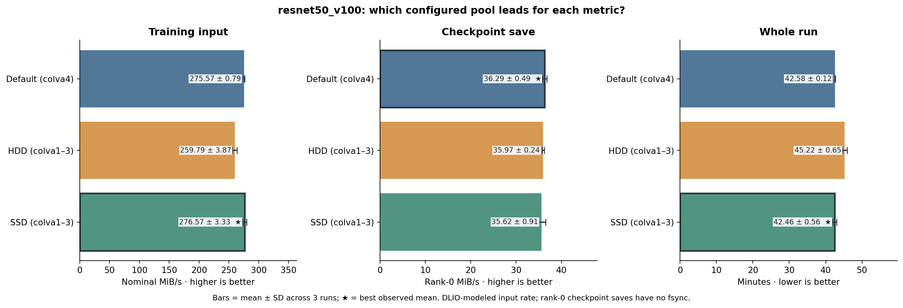

# ResNet-50: which pool leads?

Source: [nine-run ResNet sweep](../../../runs/runs-20261026-010423-356906/)
and its [native-output analysis](../../../runs/runs-20261026-010423-356906/analysis/report.md).
The [pool-level values](comparison.csv) and [three values per pool](comparison_runs.csv)
accompany the figures.

**Reading this figure:** SSD and Default have close DLIO-modeled training
rates (276.57 versus 275.57 MiB/s); HDD is lower (259.79 MiB/s).
Default has the numerically highest rank-0 checkpoint-save mean (36.29
MiB/s), while SSD has the shortest whole-run mean (42.46 min, versus
42.58 for Default). Those close differences are **descriptive**, not
established tier winners from three runs.

Training MiB/s is DLIO's sample-based modeled rate, not measured physical
reads. Checkpoint throughput is one rank's file bytes/save duration:
**no `fsync`, no eight-rank aggregate timer**. Default targets are all on
`colva4` while HDD/SSD span `colva1–3`.

Supporting plots:

- [Training across epochs](training_epochs.png) — modeled rate and measured
  training-block duration. SSD repetition 1 has a 60-second gap *before*
  checkpoint timing in epoch 2, marked in the source analysis.
- [Checkpoint events](checkpoint_rank0.png) — rank-0 duration and rate at
  epochs 2 and 4.
- [Three repetitions](training_repetitions.png) — native training mean by run.
- [Rank loading tail](rank_load_p95.png) — application-level step load times,
  not POSIX read latency.
- [Input file-to-OST assignments](dataset_ost_assignments.png) — file counts,
  not bytes or device traffic.
