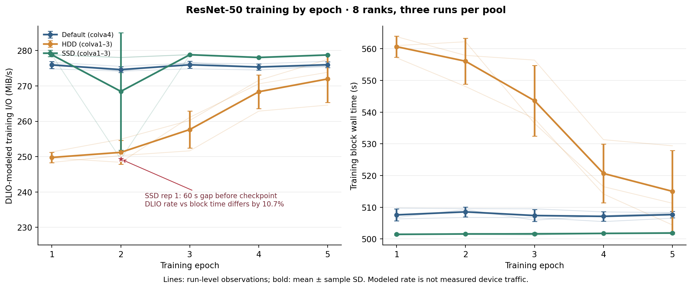
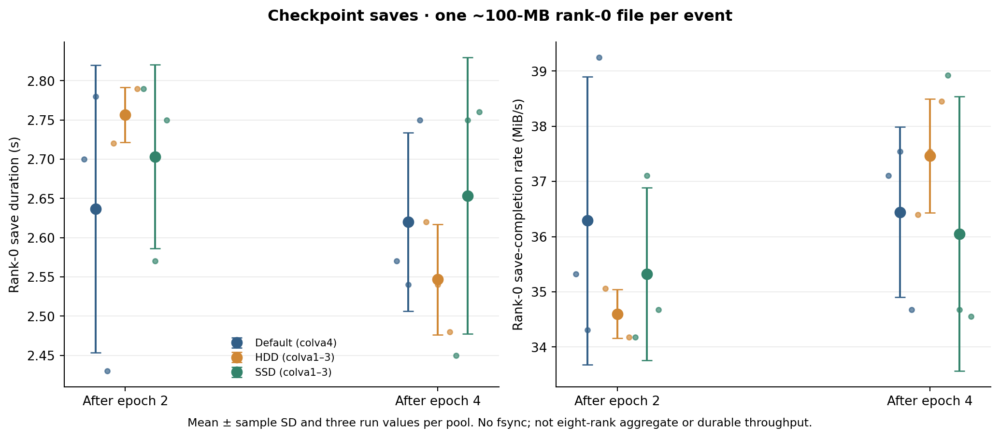
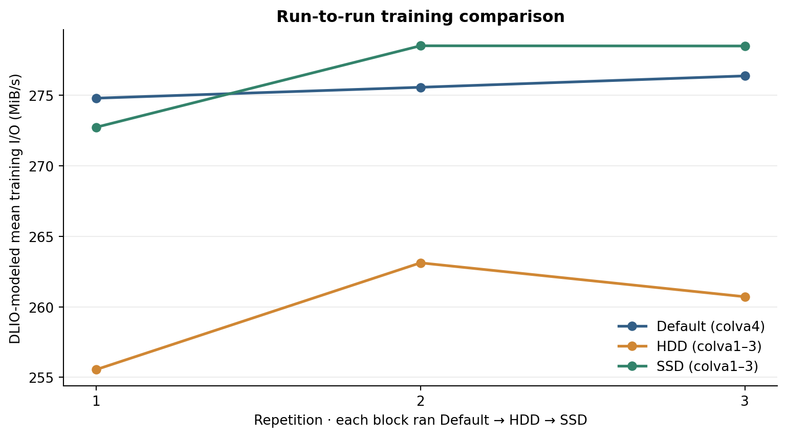
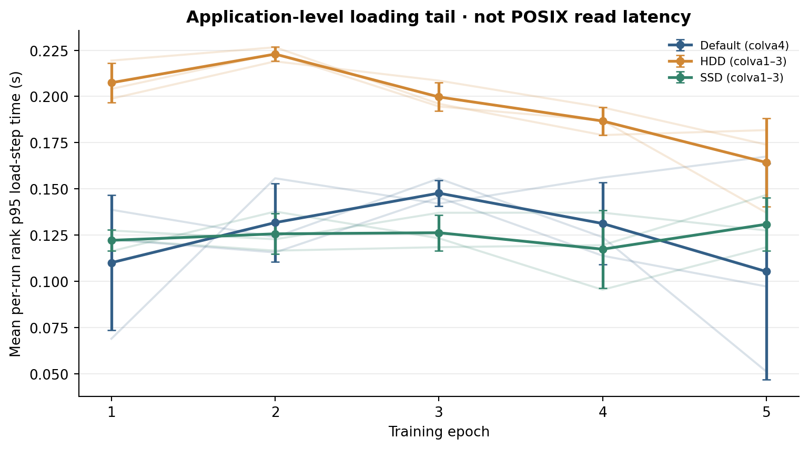
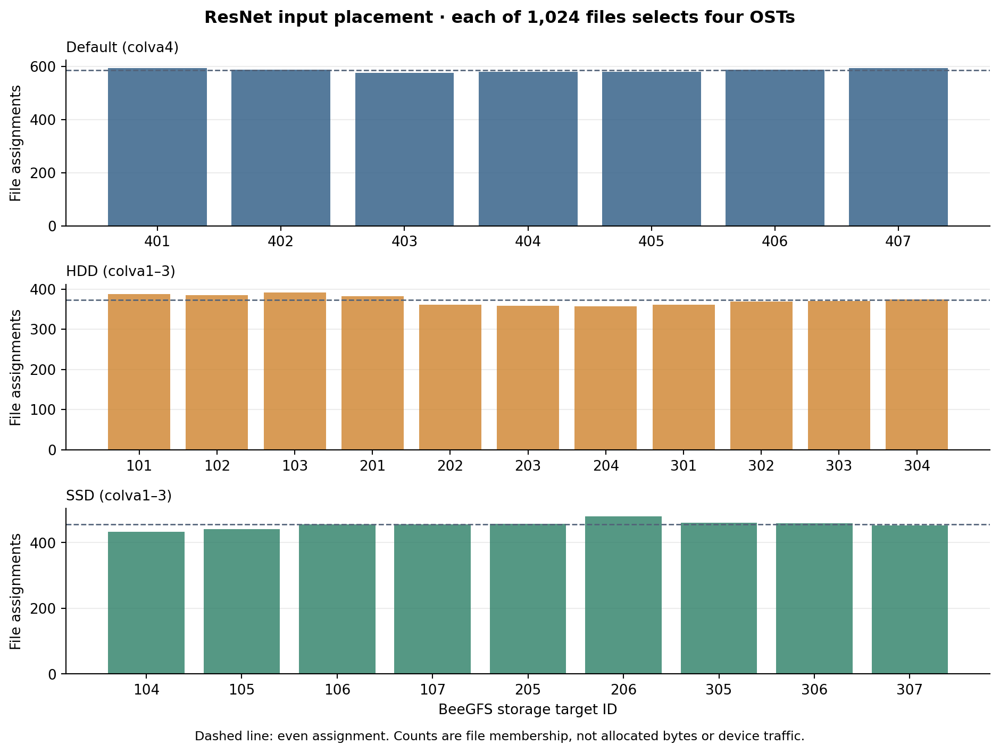

# ResNet DLIO figures

## Training Epochs

Per-epoch DLIO modeled rate and measured training-block duration; the timing anomaly is marked.

## Checkpoint Rank0

Rank-0 checkpoint save completion only; no fsync and no eight-rank aggregate rate.

## Training Repetitions

DLIO training summary for each serial repetition and pool.

## Rank Load P95

Per-rank application-step load p95, summarized first within each run.

## Dataset Ost Assignments

Number of input files assigned to each OST; not bytes or traffic.
