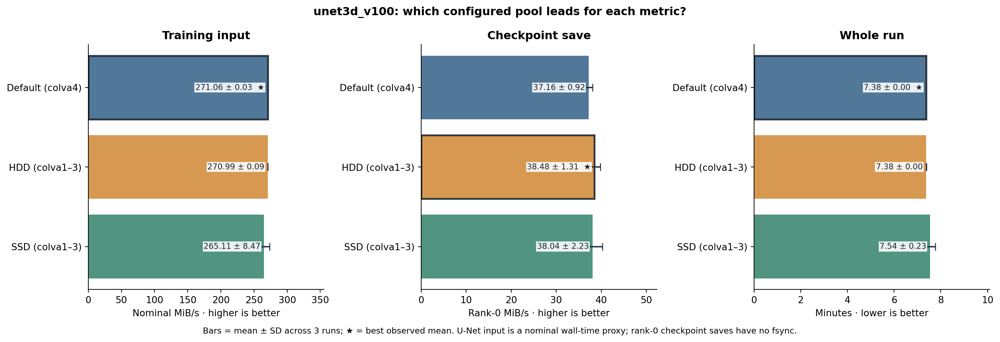
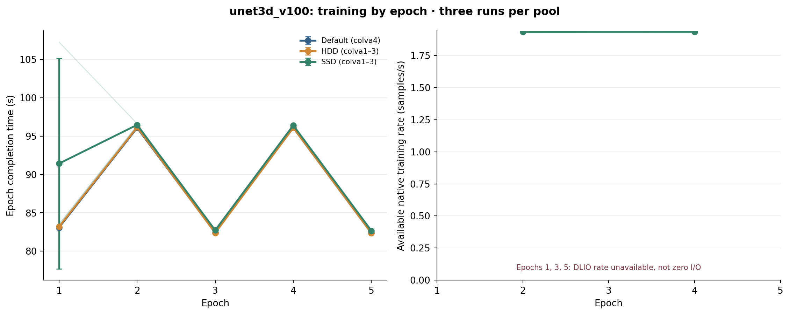
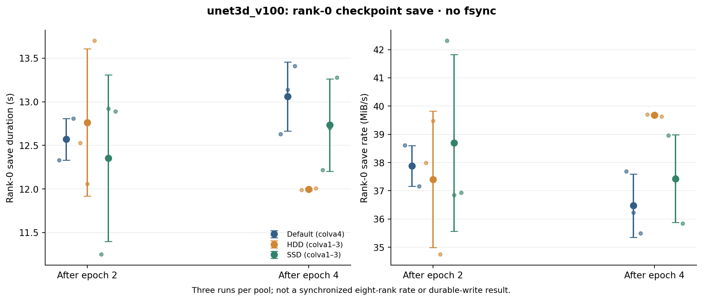
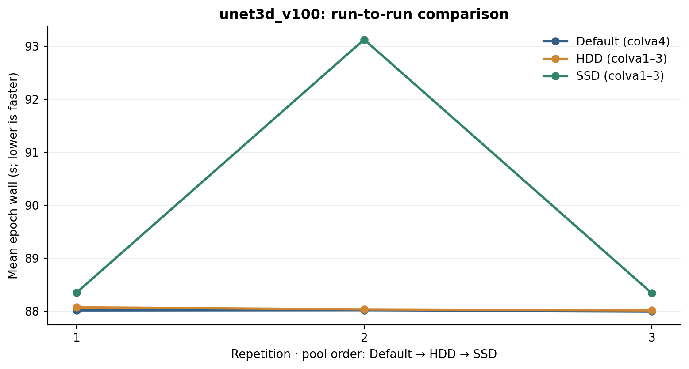
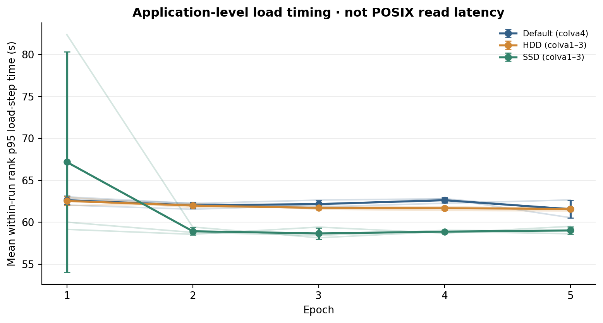
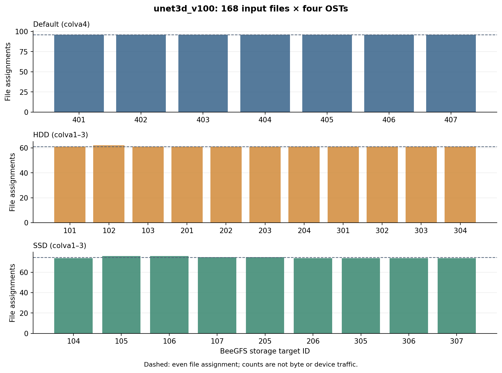

# unet3d_v100 figures

## Pool Comparison

Pool ranking by input, checkpoint, and whole-run metrics; read the phase-specific caveats.

## Training Epochs

Per-epoch training measurements; absent U-Net native rates are not plotted as zeros.

## Checkpoint Rank0

Rank-0 checkpoint save completion without fsync.

## Training Repetitions

Run-to-run comparison across the fixed pool order.

## Rank Load P95

Application-level per-rank loading-step p95, summarized by run.

## Dataset Ost Assignments

Input file assignments per OST; not bytes or traffic.
