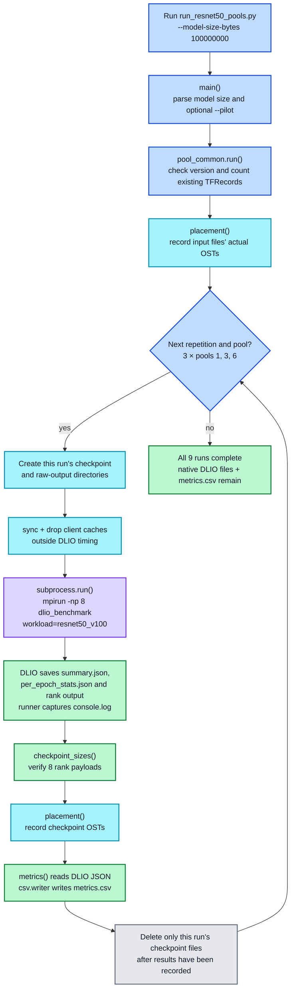
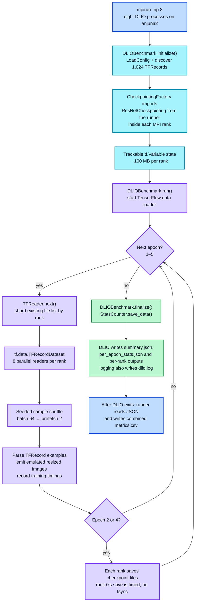

# DLIO BeeGFS pool runs

Run these commands on `anjuna2` from the repository root with DLIO 2.0.0.
They compare the existing BeeGFS pools: 1 (Default on `colva4`), 3 (HDD),
and 6 (SSD). Each file uses four targets and 512-KiB chunks. The workload
data lives under `/mnt/beegfs/pfs/tejas/dlio/<workload>/`; logs and CSVs go
under `~/tejas/dlio/<workload>/`.

## One workload at a time

| Workload | Data preparation | Short pilot | Full comparison |
|---|---|---|---|
| ResNet-50 | `python3 scripts/workloads/dlio/generate_data.py --resnet` | `python3 scripts/workloads/dlio/run_resnet50_pools.py --model-size-bytes 100000000 --pilot` | `python3 scripts/workloads/dlio/run_resnet50_pools.py --model-size-bytes 100000000` |
| U-Net 3D | `python3 scripts/workloads/dlio/generate_data.py --unet` | `python3 scripts/workloads/dlio/run_unet3d_pools.py --pilot` | `python3 scripts/workloads/dlio/run_unet3d_pools.py` |
| CosmoFlow | `python3 scripts/workloads/dlio/generate_data.py --cosmoflow` | `python3 scripts/workloads/dlio/run_cosmoflow_pools.py --pilot` | `python3 scripts/workloads/dlio/run_cosmoflow_pools.py` |

First prepare the data, then inspect the pilot's checkpoint files and native
`per_epoch_stats.json` before launching its full comparison. The pilot uses
pool 1, two steps in each of two epochs, and retains its checkpoint files.
The full runner uses eight MPI ranks and five epochs; it executes three
repetitions of pools 1, 3, and 6 sequentially, checkpointing after epochs
2 and 4. `sync` and a client cache drop precede each measured run, and its
checkpoint files are removed only after the raw results and OST placements
have been recorded. OST and cache commands require `sudo` access.

`generate_data.py` uses DLIO to generate pool 1's data, then copies the same
bytes to pools 3 and 6 under their BeeGFS patterns. It reuses existing
complete datasets (including the previously generated ResNet copies) and
stops if a dataset is partial. It never regenerates data during a timed run.
It also creates an empty `dataset/valid/` directory in every pool: DLIO 2.0.0
lists that path at startup even when evaluation is disabled. Re-running the
generator repairs a missing `valid/` without regenerating complete training
datasets.
This CosmoFlow variant uses 131,072 files of roughly 2.83 MB **per pool**
(one quarter of the native file count, approximately 370 GB per pool). The
generator and runner both override DLIO's default file count. Confirm time,
free space, and inode availability before preparing it.

The full-run `metrics.csv` contains DLIO training rates and rank-0 checkpoint
save rates computed from rank-0 output-file bytes and DLIO's rank-0 duration.
Its `raw_output` column identifies the preserved DLIO output directory.
Checkpoint saves in DLIO 2.0.0 do **not** include `fsync`: these are
application-observed save-completion rates, not durable-write or eight-rank
aggregate rates. The CosmoFlow OST listing samples 65 input files per pool;
ResNet and U-Net list every input file. None of these commands runs the full
factor matrix or checkpoint-recovery suite in `docs/specs/DL_Experiment.md`.

### U-Net native timing gap

In DLIO 2.0.0, U-Net can process all five batches in an epoch but omit
`block1.duration` and report zero training samples/s in epochs without a
checkpoint. Those zeros are **missing training metrics, not zero I/O**. The
runner records the available native epoch wall time as
`training_epoch_wall_only` and labels the native five-epoch mean
`training_summary_incomplete`; it does not invent a read throughput.
It checks that all eight ranks have load-step records before using this label.
There is no resume mode: if a run is broken, leave its old evidence intact
and start a fresh sweep with `python3 scripts/workloads/dlio/run_unet3d_pools.py`.

`pool_common.py` contains the mechanics shared by the three small runners.
Each checkpoint class remains inside its workload runner so DLIO can import
it in every MPI rank without changing the installed DLIO package.

## Analyze a copied sweep offline

Copy the completed `runs-.../` directory (including `metrics.csv`, the nine
`rep*-pool*/` directories, and placement TSVs) to your local machine. From
the repository root, with PyYAML and Matplotlib installed, use **one command**
for tables, report, and plots:

```bash
python3 scripts/workloads/dlio/analyze.py --unet results/workloads/runs/runs-20261026-164248-962399 --overwrite
python3 scripts/workloads/dlio/analyze.py --resnet results/workloads/runs/runs-20261026-010423-356906 --overwrite
```

Use `--cosmoflow` for a completed CosmoFlow sweep. The analyzer validates
nine completed runs and writes `analysis/report.md`, `comparison.csv` and
`comparison_runs.csv` (three run-level values per pool), plus
`pool_summary.csv`, `epochs.csv`, `rank_epochs.csv`, `checkpoints.csv`,
`runs.csv`, `dataset_ost_counts.csv`, and six PNGs in `analysis/plots/`.
Open `analysis/plots/README.md` to view all figures. `--overwrite` deliberately
replaces previous analysis outputs; the native run files remain unchanged.
The analyzer uses local `rep*-pool*/` files rather than absolute paths from
the cluster CSV. `rank_epochs.csv` contains application-level step loading
and processing times, **not** POSIX read/write counters. Checkpoint rates
are rank-0 save completion without fsync or an eight-rank aggregate timer.
For U-Net, absent native training rates in epochs 1, 3, and 5 are left blank:
the report compares epoch wall time across all five and native sample rates
only for epochs 2 and 4. The original checkpoint payloads were removed by the
runner; their rank-0 size and OST placement records were retained.
For a presentation-friendly navigation path, curated copies of the completed
ResNet and U-Net figures are indexed under
[results/workloads/plots/dlio/](../../../results/workloads/plots/dlio/README.md).
Those copies retain links to their raw run directories. This analyzer keeps
its own run-specific plots beside the source analysis; it does not modify the
BeeGFS training datasets or rerun DLIO.

## ResNet call chain

This diagram describes the reorganized runner, not the older ResNet script
used for the first completed cluster sweep. Its Python call chain and
checkpoint-class import path changed; the measurement intent is the same.

**Color key:** blue = runner control; cyan = preparation/placement; purple =
DLIO executing the workload; green = results/analysis; gray = cleanup.



`--pilot` takes the same path but runs only pool 1, two steps in each of two
epochs, with a 16-MiB model state per rank. It keeps its checkpoint files for
inspection. Neither path generates training data during the measurement.

## Inside each DLIO ResNet process: input and checkpoints

The launched `mpirun` creates eight processes on the client. DLIO, not the
outer runner, performs the training reads and checkpoint saves:



**Who writes each metric file?** DLIO's `StatsCounter.save_data()` writes the
native `summary.json`, `per_epoch_stats.json`, and `<rank>_output.json` files;
DLIO's logger also writes `dlio.log`.
The runner redirects DLIO's terminal output to `console.log`. After DLIO
returns, the runner's `pool_common.metrics()` reads the native JSON and
`csv.writer` appends rows to `metrics.csv`. The `training_input_block` row
uses DLIO's training-block duration and samples/s; `checkpoint_save_rank0`
divides rank 0's actual file bytes by DLIO's rank-0 save duration. DLIO
parses TFRecords but substitutes an emulated resized image; it does not
train ResNet.
